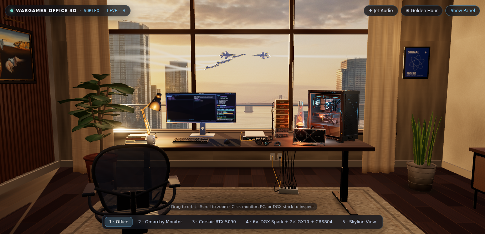
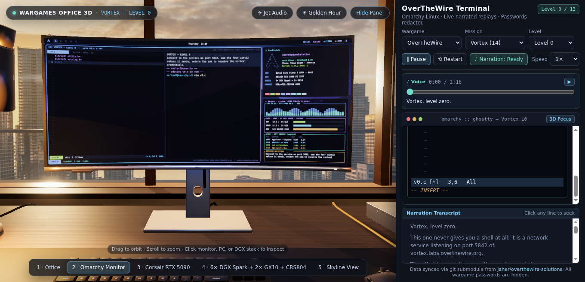
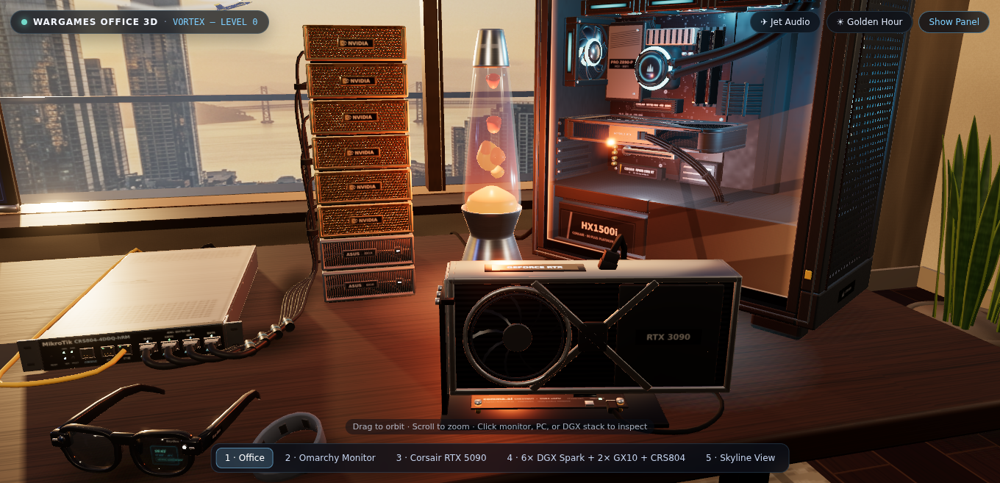
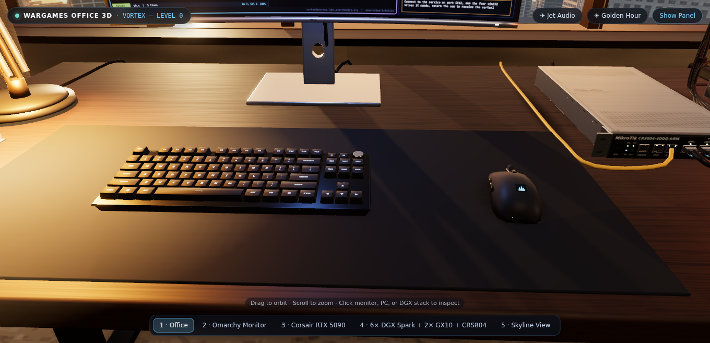
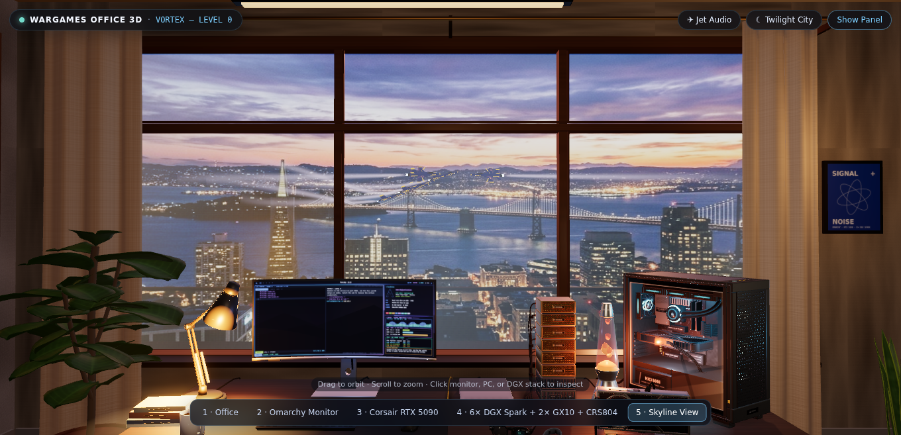
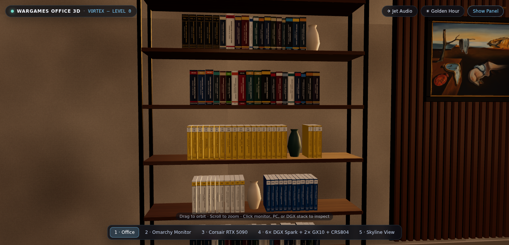

# Wargames Office 3D

An interactive Three.js 3D office experience showcasing live, voice-narrated [OverTheWire](https://overthewire.org/) and SmashTheStack wargame solutions inside a realistic modern workstation.

**Live Site:** https://jaher.github.io/wargames-office-3d/



## Screenshots

### Omarchy Linux Monitor & Voice-Narrated Terminal


### Compute Cluster, comma.ai Chestnut + RTX 3090 FE, Lava Lamp & Corsair RTX 5090 PC


### Desk Peripherals & Corsair K70 PRO TKL


### Panoramic Window Vista — Twilight City & Blue Angels Airshow


### Classic CS & Springer Mathematics Bookshelf


## Features

- **Realistic 3D Office Interior** — Hardwood oak flooring, woven area rug, Uplift V2 walnut desk, Herman Miller Aeron chair, **Corsair K70 PRO TKL** aluminum mechanical keyboard with accurate ANSI layout and rotary dial, **Corsair M75** wireless mouse, **Meta Ray-Ban Display** smart glasses (`51-23-150` Wayfarer frame with monocular right-lens waveguide HUD) & **Meta Neural Band**, Anglepoise Type 75 brass desk lamp, **Mathmos Astro Classic** animated lava lamp, **Google Nest Learning Thermostat (3rd Gen)** mounted beside the walnut entrance door, museum-framed **Salvador Dalí — *The Persistence of Memory*** oil painting, 5-shelf **Classic CS & Springer Math Bookshelf** (Knuth TAOCP Vol. 1–4B, Computer Architecture, OS, Springer GTM/UTM/SUMS), organic Fiddle-Leaf Fig & Sansevieria plants, pleated linen window curtains, and live physically-based Three.js lighting and soft shadows.
- **Photorealistic Panoramic Window View & Live Blue Angels Airshow** — Large walnut-mullioned window overlooking high-resolution photographic metropolitan vistas (San Francisco Bay Bridge Golden Hour, Twilight Harbor Skyline, and Morning Light) with 6 **U.S. Navy Blue Angels F/A-18E Super Hornets** flying continuous closed-loop maneuvers (Diamond vertical loops, formation barrel rolls, opposing knife-edge passes) with billowing contrails and a live Doppler-shifted Web Audio jet engine soundscape.
- **Corsair 5000D Airflow + RTX 5090 Founders Edition** — Accurate Blender-modeled Corsair 5000D Airflow mid-tower with triangular-perforated front/top mesh, crystal-clear tempered glass side panel, Corsair iCUE LINK LCD liquid cooler, 4× Vengeance DDR5 RGB sticks, live spinning fans, and a true 2-slot **NVIDIA GeForce RTX 5090 Founders Edition** inside the chassis.
- **comma.ai Chestnut USB4 eGPU + NVIDIA GeForce RTX 3090 Founders Edition** — Open-air CNC matte-black aluminum dock with exposed `comma.ai CHESTNUT` PCB on brass standoffs, yellow XT60i 12V power input, USB4 Type-C host link, and a 3-slot **NVIDIA GeForce RTX 3090 Founders Edition** with brushed titanium X-frame, illuminated `GEFORCE RTX` top spine, and dual spinning push-pull axial fans.
- **6× NVIDIA DGX Spark + 2× ASUS Ascent GX10 Cluster & MikroTik CRS804-4DDQ-hRM** — Positioned right on the desk alongside the monitor: 8 GB10 compute nodes wired via 4× 400G-to-2×200GbE QSFP-DD breakout DAC cables to a half-width 1U **MikroTik CRS804-4DDQ-hRM** switch with 4× 400G QSFP56-DD cages, 2× 10GbE RJ45, serial console, and live status LEDs.
- **Live Omarchy Linux Monitor** — Curved 34" Dell UltraSharp U3425WE monitor rendering an authentic **Omarchy Linux** (Arch + Hyprland borderless tiling + Tokyo Night Waybar + Ghostty + Neovim + `fastfetch` + `btop++`) desktop whose terminal updates in real time as you navigate wargames and levels.
- **Full-Scene Loading Preamble & Synced Voice Narration** — Holds a full-viewport progress preamble until every 3D model, skyline panorama, solution set, and narration track is loaded, with voice narration enabled by default, interactive timeline scrubbing, and clickable transcript seeking.
- **No Passwords Exposed** — OverTheWire and SmashTheStack level passwords are never rendered anywhere in the terminal, transcript, or 3D monitor.

## Controls

- **Orbit / Zoom:** Drag to rotate, scroll to zoom.
- **Click to Inspect:** Click the monitor, Corsair RTX 5090 PC, 8× DGX Spark stack, or panoramic window in 3D to glide the camera into position.
- **Camera Presets:** Use the bottom bar or press keys `1`–`5`:
  - `1` — Office overview
  - `2` — Omarchy Linux monitor close-up
  - `3` — Corsair RTX 5090 rig close-up
  - `4` — 8× DGX Spark + MikroTik CRS804 cluster
  - `5` — Panoramic city skyline view
- **Toggle Side Panel:** Press `P` or click **Hide Panel / Show Panel**.
- **Lighting Mood:** Click the sky button in the top-right corner to cycle between *Golden Hour*, *Twilight City*, and *Morning Light*.

## Data Source & Updating the Submodule

All wargame solution data, narration audio (`.mp3`), and sync transcripts (`.sync.json`) are read directly from the [`overthewire-solutions`](https://github.com/jaher/overthewire-solutions) git submodule pinned to its `main` branch.

To clone this repository with the submodule included:

```bash
git clone --recurse-submodules https://github.com/jaher/wargames-office-3d.git
```

To pull the latest OverTheWire solutions and narration updates from the submodule:

```bash
git submodule update --remote
git add overthewire-solutions
git commit -m "Update overthewire-solutions submodule"
git push
```

## Running Locally

This is a static site with no build step (Three.js is loaded via an ES module import map). Serve the repository root with any local HTTP server:

```bash
python3 -m http.server 8000
```

Then open http://localhost:8000 in a WebGL-capable browser.
